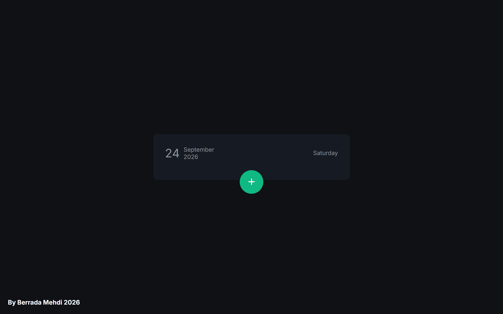
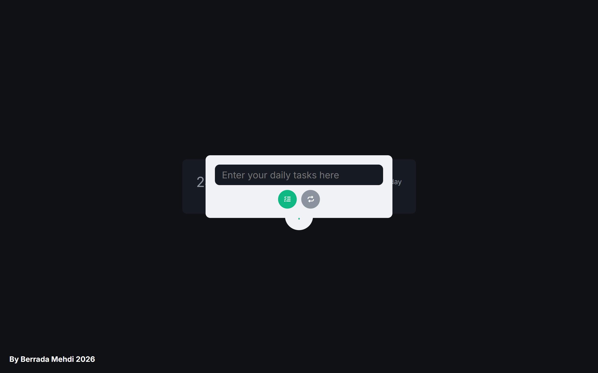
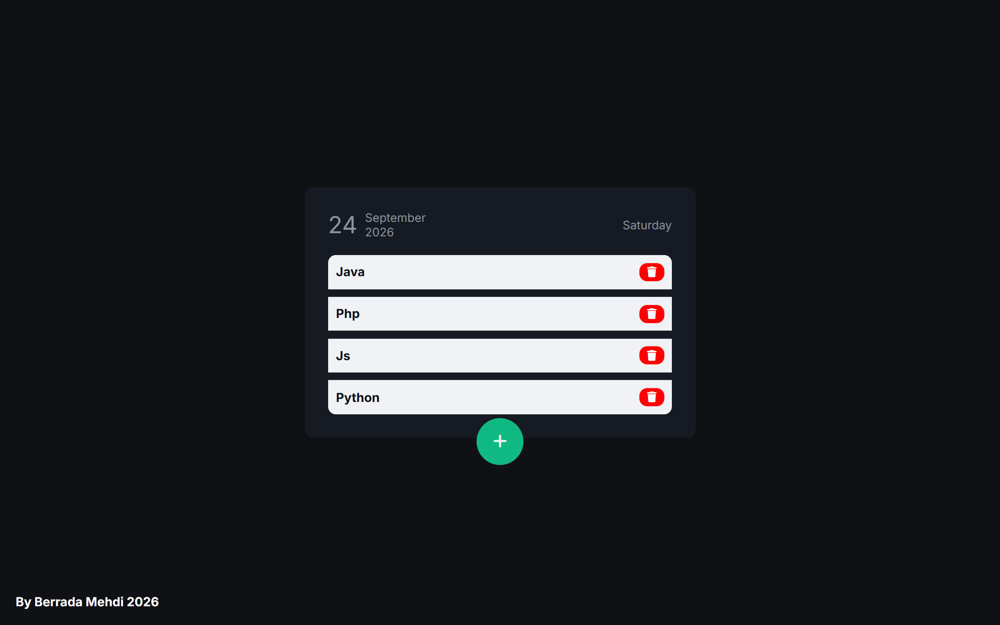

# Modern Todo List 📝

A sleek, minimalist daily task manager web application built with HTML5, CSS3, and JavaScript, featuring a clean dark UI and smooth interactive modal states.

---

## 📱 App Interface & States

<p align="center">
  
  
  
</p>

---

## ✨ Features

- **Daily Tracker:** Clean header displaying the current date and day.
- **Interactive Modal:** Smooth popup interface to input new daily tasks.
- **Task Management:** Easily add and delete tasks dynamically.
- **Modern Dark UI:** Ergonomic dark theme with high-contrast accent buttons.

---

## 🛠️ Tech Stack

- **Markup:** HTML5
- **Styling:** CSS3 (Flexbox, Custom Properties)
- **Logic:** Vanilla JavaScript (DOM Manipulation, Event Handling)

---

## 🚀 Getting Started

### Prerequisites
A modern web browser (Google Chrome, Mozilla Firefox, Microsoft Edge, Safari).

### Installation
1. Clone the repository:
   ```bash
   git clone [https://github.com/berradamehdi/Todo-App-Js.git](https://github.com/berradamehdi/Todo-App-Js.git)